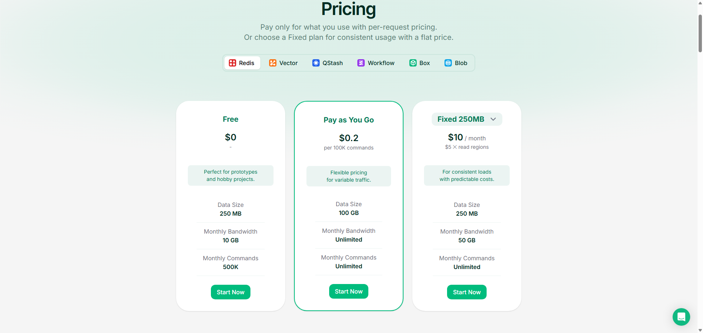

# InstaBox 保活面板

给 InstaBox 云机器做 7×24 保活的可视化管理面板。单文件 Cloudflare Worker，前端页面、API 代理、定时保活全部内嵌在 `worker.js` 里，配置与日志存放在 Upstash Redis。

## 为什么需要它

InstaBox 的机器空闲 30 分钟会自动暂停。免费账号的 `autoSuspendAfterSeconds` 只允许在 5–30 分钟之间取值，`0`（关闭空闲暂停）需要账号具备 manual lifecycle 权限，该权限由服务端管理员控制。

本面板通过 **activity lease（活动租约）** 保活：租约有效期内机器不会进入空闲暂停，定时续期即可长期运行。租约单次最长 3600 秒，配合 15 分钟一次的定时任务，即使连续几次请求失败也不会中断。

## 功能

- 机器列表与实时状态（运行中 / 已暂停 / 已停止 / 操作过渡态）
- 启动、唤醒、暂停、停止、删除
- 每台机器独立开关自动保活，显示上次保活、下次保活与租约剩余时间
- 保活日志，保留最近 200 条
- 面板密码保护，所有接口需鉴权
- 操作按钮防重复点击，操作期间整张卡片锁定

## 界面预览

登录后进入控制台，顶部可在「机器」与「日志」之间切换。

**登录**


**机器列表**：每张卡片显示状态、规格、操作按钮，以及自动保活的上次/下次保活时间与租约剩余。


**保活日志**：记录每次续期与手动操作，存于 Upstash Redis，可一键清空。


## 保活效果


**近 24 小时资源曲线**：CPU、内存、磁盘、网络、负载与延迟均有完整采样，没有因暂停出现的断档。


## 前置条件

| 依赖 | 获取方式 |
|---|---|
| InstaBox API Key | 登录 [InstaBox 控制台](https://dashboard.instabox.sh/dashboard/machines)，进入 **Profile → API keys** 创建，`ibk_` 开头 |
| Upstash Redis | 在 [Upstash](https://upstash.com) 创建，步骤见下方 |
| Cloudflare 账号 | 免费注册，登录 [Cloudflare Dashboard](https://dash.cloudflare.com) |

## 准备 Upstash Redis

1. 打开 <https://upstash.com>，点 **Sign In**，选择 **Continue with GitHub** 直接登录，不需要单独注册。
2. 进入控制台选择 Redis 进行创建，区域挑离你较近的节点，计划保持 **Free**。
3. 创建完成后进入数据库详情页，在 **REST API** 区域复制两个值，稍后填入 Worker 环境变量：
   - `UPSTASH_REDIS_REST_URL`
   - `UPSTASH_REDIS_REST_TOKEN`

免费额度为每月 **500,000 次命令**、**250 MB 存储**、**10 GB 带宽**。本面板每 15 分钟续期一次，一天约 96 轮，每轮几条命令，月消耗不到 1.5 万次，占免费额度不足 3%。



## 部署

### 方式一：Cloudflare 网页控制台

1. 打开 [Cloudflare Dashboard](https://dash.cloudflare.com) → **Workers & Pages** → **Create** → **Worker**
2. 命名（例如 `instabox-panel`）后点 **Deploy**，先用默认模板部署
3. 点 **Edit code**，删除默认代码，粘贴 `worker.js` 全文，点 **Deploy**
   > 编辑器默认就是 ES Module 格式，代码使用 `export default`，直接粘贴即可，不要切换为 Service Worker 类型。
4. 进入 **Settings → Variables and Secrets**，逐个添加以下四个变量，类型全部选择 **Secret**：

   | 变量名 | 值 |
   |---|---|
   | `INSTABOX_API_KEY` | InstaBox 的 API Key |
   | `ADMIN_PASSWORD` | 面板登录密码，自行设定 |
   | `UPSTASH_REDIS_REST_URL` | Upstash Redis 的 REST 地址 |
   | `UPSTASH_REDIS_REST_TOKEN` | Upstash Redis 的 REST 令牌 |

   添加完成后点 **Deploy** 使其生效。
5. 进入 **Settings → Trigger Events → Cron Triggers**，点 **Add**，填入：

   ```
   */15 * * * *
   ```

6. 访问 `https://<worker 名称>.<你的子域>.workers.dev`，输入 `ADMIN_PASSWORD` 登录。

### 方式二：wrangler CLI

```bash
npm install -g wrangler
wrangler login

wrangler deploy

wrangler secret put INSTABOX_API_KEY
wrangler secret put ADMIN_PASSWORD
wrangler secret put UPSTASH_REDIS_REST_URL
wrangler secret put UPSTASH_REDIS_REST_TOKEN
```

CLI 部署需要在同目录自行创建 `wrangler.toml`：

```toml
name = "instabox-panel"
main = "worker.js"
compatibility_date = "2026-10-01"

[triggers]
crons = ["*/15 * * * *"]
```

## 环境变量

| 变量 | 必填 | 说明 |
|---|---|---|
| `INSTABOX_API_KEY` | 是 | InstaBox API Key，需具备 `machines:write` 或 `machines:exec` 权限 |
| `ADMIN_PASSWORD` | 是 | 面板登录密码，所有 `/api` 请求通过 `X-Panel-Auth` 头校验 |
| `UPSTASH_REDIS_REST_URL` | 是 | 形如 `https://xxx.upstash.io` |
| `UPSTASH_REDIS_REST_TOKEN` | 是 | Upstash 数据库的 REST Token |

## 使用

**机器页**：卡片展示机器名称、状态、机器 ID、规格与模板。操作按钮随状态变化：

- 运行中 → 暂停、停止
- 已暂停 → 唤醒
- 已停止 → 启动

暂停和停止都会弹出确认。两者的区别：

| 操作 | 效果 |
|---|---|
| 暂停 | 保留内存和运行中的进程，唤醒后从原地继续 |
| 停止 | 相当于关机，只保留 `/data` 里的文件，下次启动是冷启动 |

**自动保活开关**：打开后立即续期一次，卡片显示上次保活、下次保活与租约剩余时间。手动暂停或停止某台机器时，该机器的保活会自动关闭，避免定时任务将其重新拉起。

**日志页**：查看最近 50 条保活与操作记录，可一键清空。日志存放在 Redis，与浏览器无关。

## 保活机制

1. Cloudflare 的 Cron 触发器（`*/15 * * * *`）按计划调用 Worker 导出的 `scheduled()` 处理函数，由它执行保活任务：对所有开启保活的机器调用 `PUT /v1/machines/{id}/activity-leases/keepalive`，租约时长 3600 秒。
2. 租约有效期内机器不会空闲暂停；租约到期后才重新开始计算 30 分钟空闲时间。
3. 机器处于 `stopped` 状态时租约接口会拒绝，任务会自动下发 `POST /v1/machines/{id}/start`。
4. 定时任务每轮把结果写回 Redis，并在日志中留下记录。

`fetch()` 处理面板页面与 API 请求，`scheduled()` 只负责定时保活，两者互不影响。因为单次租约就有 1 小时，即使定时任务连续失败两三次，机器也不会进入暂停。

## 存储结构

| Key | 类型 | 内容 |
|---|---|---|
| `instabox:machines` | Hash | field 为机器 ID，value 为 JSON：保活开关、租约到期时间、上次执行结果 |
| `instabox:logs` | List | 保活与操作日志，`LPUSH` + `LTRIM` 保留最近 200 条 |

## 常见问题

**定时任务没有生效**

确认 **Trigger Events → Cron Triggers** 已添加并保存。可在 Worker 的 **Logs** 中查看 `scheduled` 事件，成功时输出 `{"event":"keepalive_tick_ok",...}`。

**保活开关打开后状态没有更新**

检查 `UPSTASH_REDIS_REST_URL` 与 `UPSTASH_REDIS_REST_TOKEN` 是否正确。面板顶部会显示 Redis 读取失败的提示。

**机器仍然会暂停**

确认该机器的保活开关为开启状态，且日志页有持续的「自动保活」记录。若日志中出现 `HTTP 404 not_found`，说明 Redis 里存在无效的机器 ID，清空后重新开启即可。

**能否直接把空闲暂停关掉**

不能。`autoSuspendAfterSeconds` 设为 `0` 需要账号具备 manual lifecycle 权限，该权限由服务端管理员控制；部分套餐也不支持常驻。租约方案不需要该权限。

**面板部署后是否还需要代理**

不需要。Cloudflare 的网络可直接访问 InstaBox API。

## 相关链接

**InstaBox**

- 官网 <https://instabox.sh>
- 控制台 <https://dashboard.instabox.sh/dashboard/machines> —— API Key 在 **Profile → API keys** 创建
- 文档 <https://instabox.sh/docs>
- API 地址 `https://api.instabox.sh`

**Upstash**

- 官网 <https://upstash.com> —— 支持 GitHub 账号直接登录
- 控制台 <https://console.upstash.com/redis> —— 创建 Redis 后在此复制 REST URL 与 REST Token
- Redis 文档 <https://upstash.com/docs/redis>

**Cloudflare**

- Dashboard <https://dash.cloudflare.com>
- Workers 文档 <https://developers.cloudflare.com/workers/>
- Cron 触发器 <https://developers.cloudflare.com/workers/configuration/cron-triggers/>

## 社区支持

学 AI , 上 L 站：[LinuxDO](https://linux.do)

## Star History

<a href="https://www.star-history.com/?repos=lizhenmiao%2Finstabox-keepalive&type=timeline&logscale=&legend=bottom-right">
 <picture>
   <source media="(prefers-color-scheme: dark)" srcset="https://api.star-history.com/chart?repos=lizhenmiao/instabox-keepalive&type=timeline&theme=dark&logscale&legend=bottom-right" />
   <source media="(prefers-color-scheme: light)" srcset="https://api.star-history.com/chart?repos=lizhenmiao/instabox-keepalive&type=timeline&logscale&legend=bottom-right" />
   
 </picture>
</a>
