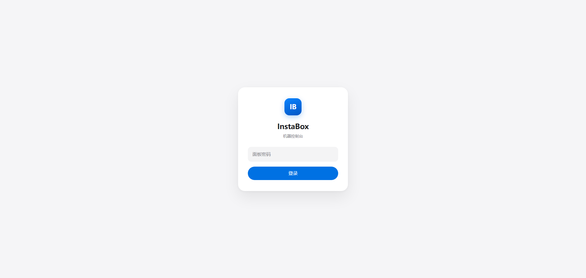
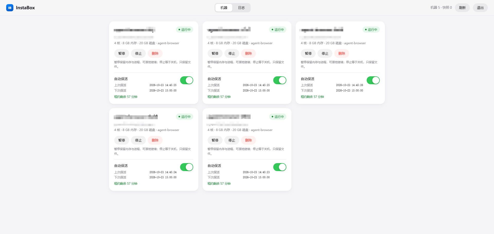
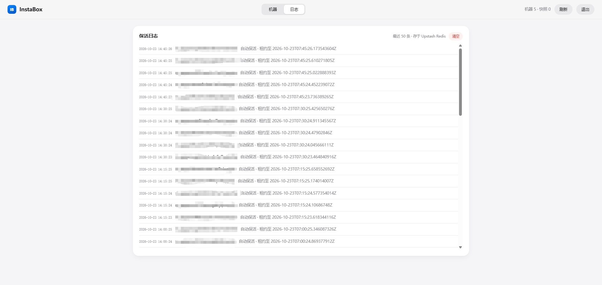
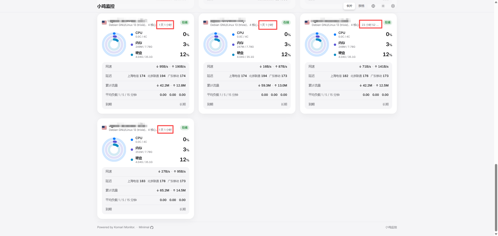
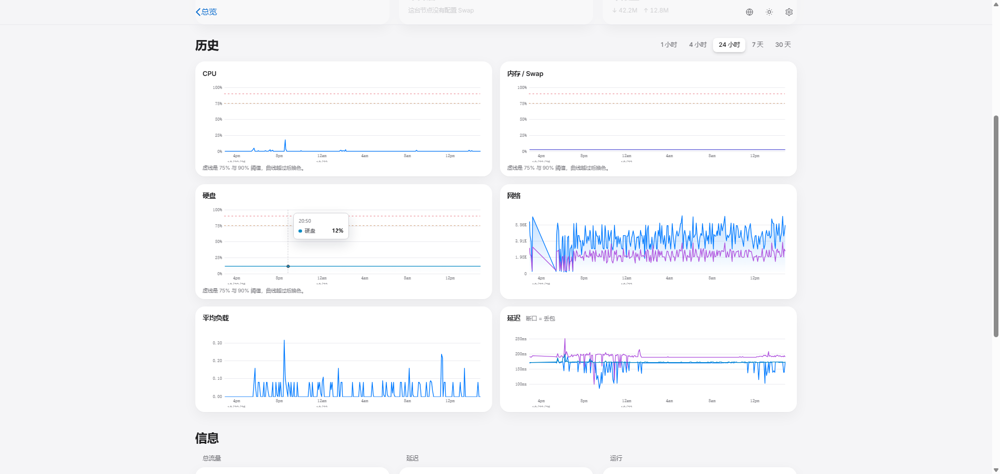

# InstaBox 保活面板

部署在 Cloudflare Workers 上的 InstaBox 机器管理与保活面板。通过活动租约定时维护指定机器，提供机器状态、保活开关和操作日志。本仓库独立维护实现与部署配置。

`worker.js` 负责面板、API 和定时任务；`storage.js` 负责 D1 持久化；`migrations/` 保存数据库迁移。

## 为什么需要它

InstaBox 的机器空闲 30 分钟会自动暂停。按当前官方文档，免费套餐固定空闲 30 分钟暂停，付费套餐可以调整或关闭空闲暂停。

本面板通过 **activity lease（活动租约）** 保活：租约有效期内维持任务活动，单次最长 3600 秒，每 15 分钟续期。租约不等于取消平台的其他运行期限或回收规则，持续保活效果须通过实际运行记录确认。

## 功能

- 机器列表与实时状态（运行中 / 已暂停 / 已停止 / 操作过渡态）
- 启动、唤醒、暂停、停止、删除
- 每台机器独立开关自动保活，显示上次保活、下次保活与租约剩余时间
- 保活日志，保留最近 200 条
- 面板密码保护，所有接口需鉴权
- 操作按钮防重复点击，操作期间整张卡片锁定

## 界面预览

登录后进入控制台，顶部可在「机器」与「日志」之间切换。

**登录**



**机器列表**：每张卡片显示状态、规格、操作按钮，以及自动保活的上次/下次保活时间与租约剩余。



**保活日志**：记录每次续期与手动操作，存于 Cloudflare D1，可一键清空。



## 上游效果参考

以下图片来自上游项目，不代表本实现已通过线上持续保活验证。



**近 24 小时资源曲线**：CPU、内存、磁盘、网络、负载与延迟均有完整采样，没有因暂停出现的断档。



## 前置条件

- Cloudflare 账号，启用 Workers 和 D1。
- InstaBox API Key，保活需要 `machines:write` 或 `machines:exec`；面板其他管理操作需要对应权限。
- 支持所锁定 Wrangler 版本的 Node.js 和 npm。

## 部署

```bash
npm ci
npx wrangler login
npx wrangler d1 create instabox-keepalive
```

把创建结果中的数据库 UUID 填入 `wrangler.toml` 的 `database_id`，替换全零占位值；绑定名保持 `DB`。然后初始化数据库：

```bash
npx wrangler d1 migrations apply instabox-keepalive --remote
npx wrangler deploy
npx wrangler secret put INSTABOX_API_KEY
npx wrangler secret put ADMIN_PASSWORD
```

`secret put` 会交互读取密钥，不要将真实值写进源码、命令参数或 Git。Worker 已配置 `*/15 * * * *` 定时触发器。首次部署到填完两个 Secret 之前，保活任务无法执行；设置完成后登录面板，只为需要维护的机器开启保活。

## 配置

| 名称 | 类型 | 说明 |
|---|---|---|
| `DB` | D1 binding | 保存机器保活配置和日志 |
| `INSTABOX_API_KEY` | Worker Secret | InstaBox API Key |
| `ADMIN_PASSWORD` | Worker Secret | 面板密码，API 使用 `X-Panel-Auth` 校验 |

## 本地验证

```bash
npm test
npx wrangler deploy --dry-run
```

测试使用 Miniflare 的本地 D1 数据库和模拟的 InstaBox API，覆盖配置更新、日志保留与事务回滚、鉴权、续租及上游失败。测试不访问真实机器，不能代替线上持续保活验证。

需要本地运行面板时，在已忽略的 `.dev.vars` 中填入两个 Secret，先执行 `npx wrangler d1 migrations apply instabox-keepalive --local`，再执行 `npx wrangler dev`。D1 由 Wrangler 在本地模拟，不需要云端数据库凭据。

## 使用

**机器页**：卡片展示机器名称、状态、机器 ID、规格与模板。操作按钮随状态变化：

- 运行中 → 暂停、停止
- 已暂停 → 唤醒
- 已停止 → 启动

暂停和停止都会弹出确认。两者的区别：

| 操作 | 效果 |
|---|---|
| 暂停 | 保留内存和运行中的进程，唤醒后从原地继续 |
| 停止 | 相当于关机，下次启动是冷启动，内存中的进程状态不保留 |

**自动保活开关**：打开后立即续期一次，卡片显示上次保活、下次保活与租约剩余时间。手动暂停或停止某台机器时，该机器的保活会自动关闭，避免定时任务将其重新拉起。

**日志页**：查看最近 50 条保活与操作记录，可一键清空。日志存放在 D1，与浏览器无关。

## 保活机制

1. Cloudflare 的 Cron 触发器（`*/15 * * * *`）按计划调用 Worker 导出的 `scheduled()` 处理函数，由它执行保活任务：对所有开启保活的机器调用 `PUT /v1/machines/{id}/activity-leases/keepalive`，租约时长 3600 秒。
2. 租约有效期内机器不会空闲暂停；租约到期后才重新开始计算 30 分钟空闲时间。
3. 机器处于 `stopped` 状态时租约接口会拒绝，任务会自动下发 `POST /v1/machines/{id}/start`。
4. 定时任务每轮把结果写回 D1，并在日志中留下记录。

`fetch()` 处理面板页面与 API 请求，`scheduled()` 只负责定时保活，两者互不影响。因为单次租约就有 1 小时，即使定时任务连续失败两三次，机器也不会进入暂停。

## 存储结构

| 表 | 内容 |
|---|---|
| `machine_configs` | `machine_id` 主键及 `config_json`：保活开关、租约期限和最近执行结果 |
| `keepalive_logs` | 自增 ID 及 `entry_json`；保留最新 200 条，面板读取最新 50 条 |

配置沿用上游 JSON 字段；所有写入值使用 SQL 参数绑定。日志新增与裁剪在同一 D1 batch 事务中执行，清空日志不会删除机器配置。此版本面向新部署，不自动导入已有 Upstash 数据。

## 常见问题

**定时任务没有生效**

确认 **Trigger Events → Cron Triggers** 已添加并保存。可在 Worker 的 **Logs** 中查看 `scheduled` 事件，成功时输出 `{"event":"keepalive_tick_ok",...}`。

**保活开关打开后状态没有更新**

检查 Worker 的 `DB` 绑定、数据库 ID，以及远端迁移是否成功执行。面板顶部会显示配置读取失败的提示。

**机器仍然会暂停**

确认该机器的保活开关为开启状态，且日志页有持续的「自动保活」记录。若日志中出现 `HTTP 404 not_found`，说明 D1 里存在无效的机器 ID，清空后重新开启即可。

**能否直接把空闲暂停关掉**

按当前官方文档，免费套餐不能关闭空闲暂停；付费套餐可设置 `autoSuspendAfterSeconds=0`。本项目使用活动租约，不修改此设置。

**面板部署后是否还需要代理**

不需要。Cloudflare 的网络可直接访问 InstaBox API。

## 相关链接

**InstaBox**

- 官网 <https://instabox.sh>
- 控制台 <https://dashboard.instabox.sh/dashboard/machines> —— API Key 在 **Profile → API keys** 创建
- 文档 <https://instabox.sh/docs>
- API 地址 `https://api.instabox.sh`

**Cloudflare**

- Dashboard <https://dash.cloudflare.com>
- Workers 文档 <https://developers.cloudflare.com/workers/>
- D1 文档 <https://developers.cloudflare.com/d1/>
- Cron 触发器 <https://developers.cloudflare.com/workers/configuration/cron-triggers/>

## 项目来源

项目起点为 [lizhenmiao/instabox-keepalive](https://github.com/lizhenmiao/instabox-keepalive)，基线提交为 `7dd559358b8c156e0d7080fd083e8af7a2000130`，保留原始 Git 历史。后续实现与部署配置在本仓库独立维护。
